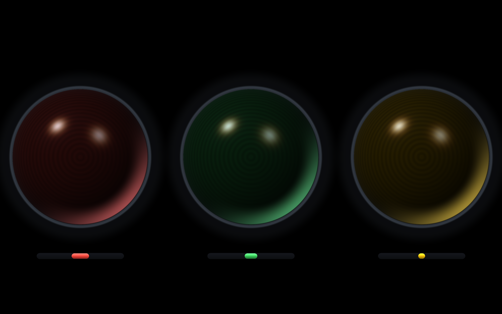
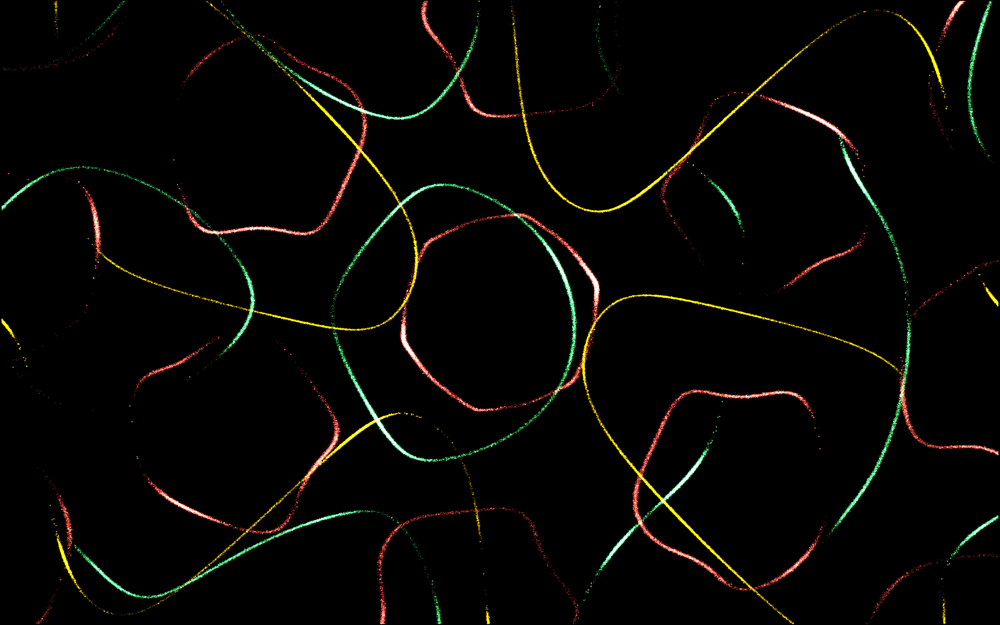
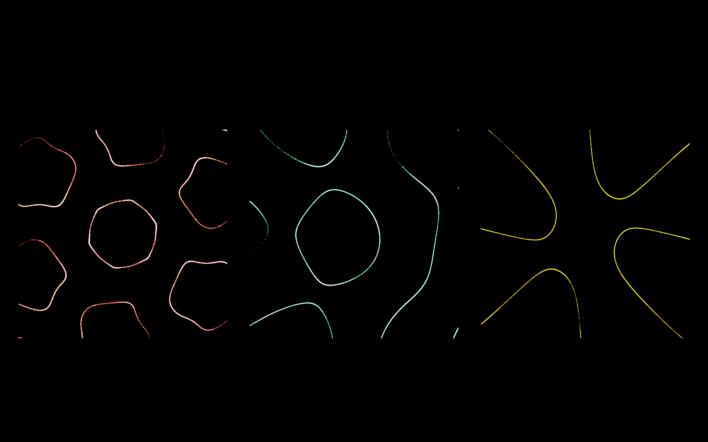

# 🚦 TrafficLight — a frequency traffic light & Chladni figures

Music visualization for Windows: it listens to system audio (WASAPI loopback)
or the microphone, splits the spectrum into three colour bands and reacts to
them — either as a retro incandescent traffic light, or as “Chladni plates”
where tens of thousands of GPU particles gather into standing-wave patterns in
time with the music.

| Colour | Band |
|--------|------|
| 🔴 Red | Bass, 20–250 Hz |
| 🟢 Green | Mids, 250 Hz – 2 kHz |
| 🟡 Yellow | Highs, 2–16 kHz |

## Features

- **Three modes**: traffic light — procedural glass lenses rendered by a
  shader (concentric Fresnel ribs, hot filament core, halos, specular
  highlight, rim light, incandescent flicker); particles on three plates;
  particles on a single field — all three colours share one canvas and
  combine additively, and flashes light up particles only, never the
  background.
- **GPU physics & shaders**: up to 150,000 particles per band in a D3D11
  compute shader; the traffic light is a fullscreen pixel-shader pass. With
  no GPU available the app falls back to WPF/CPU rendering automatically.
- **Self-normalizing audio**: each band adjusts its own gain using a sliding
  95th percentile (~4 s window). The loudness of the track, recording or mic
  doesn't matter — no sliders to fiddle with. Plus a **presence gate**: if a
  band simply isn't present in the track (no bass, rolled-off highs), it does
  not amplify itself out of the noise floor — it stays dark even when
  neighbouring bands are loud.
- **OLED-friendly**: the background is pure black #000; light is emitted only
  where it is earned.
- **Fullscreen on a chosen monitor**, pixel-perfect, with mixed per-monitor
  DPI handled correctly.
- **Interface language follows the OS**: Russian UI on a Russian system,
  English everywhere else. Manual override: `TL_LANG=ru|en`.
- Manual controls: per-band trigger threshold, overall sensitivity, particle
  count, audio source, target monitor.

## Quick start

```powershell
dotnet build TrafficLight/TrafficLight.csproj -c Release
TrafficLight\bin\Release\net10.0-windows\TrafficLight.exe
```

1. In the panel pick the audio source (the system default output is
   preselected, button «Запуск» starts the analyzer).
2. Pick a mode: traffic light, three plates, or a single field.
3. **F11** — fullscreen.

> ⚠️ If you select a silent output device (e.g. an HDMI/TV port) you will get
> no audio: WASAPI loopback delivers data only while something is actually
> playing on that endpoint. For microphone input pick «Микрофон: …».

## Hotkeys

| Key | Action |
|-----|--------|
| **F11** | Fullscreen (on the selected monitor) |
| **Esc** / double-click on screen | Exit fullscreen |
| **Tab** | Hide/show the settings panel |

## How it works

- `NAudio` → `WasapiLoopbackCapture` / `WasapiCapture` (float32, ~10 ms packets).
- Mono → an 8192-sample ring buffer; every 2048 samples a Hann window + FFT (2¹³).
- Band level = the mean of the top ⅛ strongest bins within the band (sparse
  highs don't drown in empty bins); auto-gain over a rolling peak + a silence
  gate on master RMS.
- Each band's dominant frequency plus its spectral centroid (log scale)
  continuously select and cross-morph the Chladni pattern — driven by the
  music, not by timers; the pitch slope spins the pattern, spectral flux adds
  extra liveliness.
- CPU fallback path: the traffic light and particles are drawn in code in
  WPF's `OnRender`.
- Main GPU path: `GpuParticleHost` (HwndHost + D3D11) — particle physics in a
  compute shader, rendered as instanced quads with additive blending; the
  traffic light is a fullscreen pixel shader with procedural Fresnel glass.

## Project layout

```
TrafficLight/
  Audio/FftAnalyzer.cs             — FFT, bands, levels, self-normalization, pitch tracking
  Visuals/AudioVisualHost.cs       — WPF layer: traffic light + CPU particles (fallback)
  Visuals/LampField.cs             — traffic-light drawing (fallback)
  Visuals/ParticleEngine.cs        — CPU Chladni particles (fallback)
  Visuals/Gpu/GpuParticleHost.cs   — GPU: particles (compute+draw) and the shader lamps (HLSL)
  Visuals/ParticleLayout.cs        — plate/field layout (shared by CPU and GPU)
  Visuals/ChladniModes.cs          — 4 pattern families (Chladni pairs, rotation, honeycombs, rosettes)
  Visuals/Displays.cs              — monitors & fullscreen (Win32)
  MainWindow.xaml(.cs)             — settings panel, devices, fullscreen
  Lang.ru.xaml / Lang.en.xaml      — UI strings (ru/en dictionaries)
  Theme.xaml                       — dark control theme
  app.manifest                     — PerMonitorV2 DPI manifest
AnalyzeTest/                       — synthetic analyzer test (dotnet run)
AudioTest/                         — NAudio device test: loopback/mic (dotnet run)
TestHook/                          — GPU-surface double-click test (dotnet run)
skills/                            — portable how-to notes (WPF+D3D11, WASAPI, UIA)
CONTEXT.md                         — development journal & pitfall log (kept in Russian)
```

## Tests

```powershell
dotnet run --project AnalyzeTest   # FFT/bands on synthetic signals
dotnet run --project AudioTest     # device list + live capture
dotnet run --project TestHook      # GPU host double-click logic
```

## Requirements

- Windows 10/11 + .NET 10 Desktop Runtime (SDK 10 to build);
- GPU particles need a driver with Direct3D 11 feature level 11_0+
  (without it — automatic CPU fallback).

## Screenshots

**Traffic light** — ribbed glass lenses with window reflections, caustics and
pill-shaped gauges:



**Particles, single field** — all three bands on one canvas, additive colours,
the pattern fills the whole screen with no borders and no aspect squashing:



**Particles, 3 plates** — one band per Chladni plate:



## Support

If you found this project useful and want to fuel its development —
[a word of thanks on Boosty](https://boosty.to/ronozion) is much appreciated.

[](https://boosty.to/ronozion)

## License

MIT — see [LICENSE](LICENSE). Use, modify, redistribute freely.
